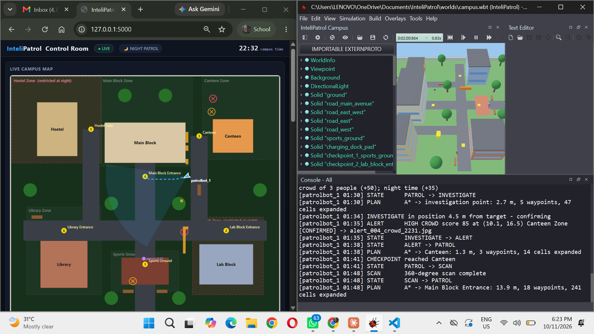
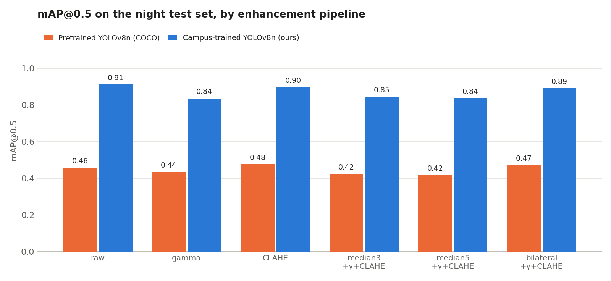
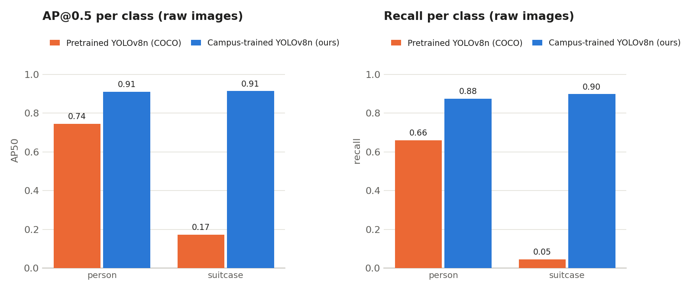
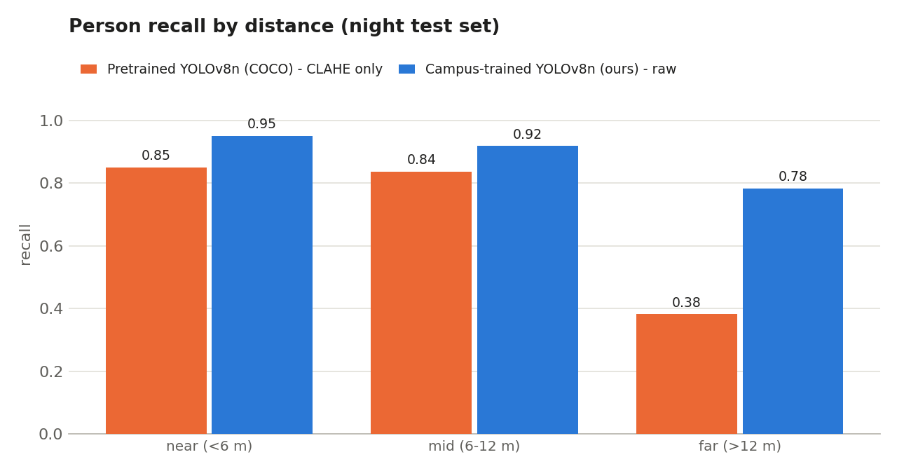
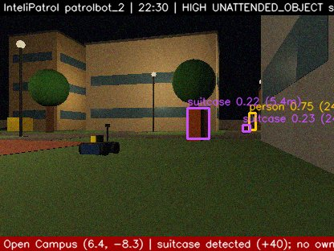
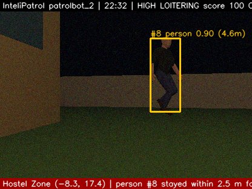
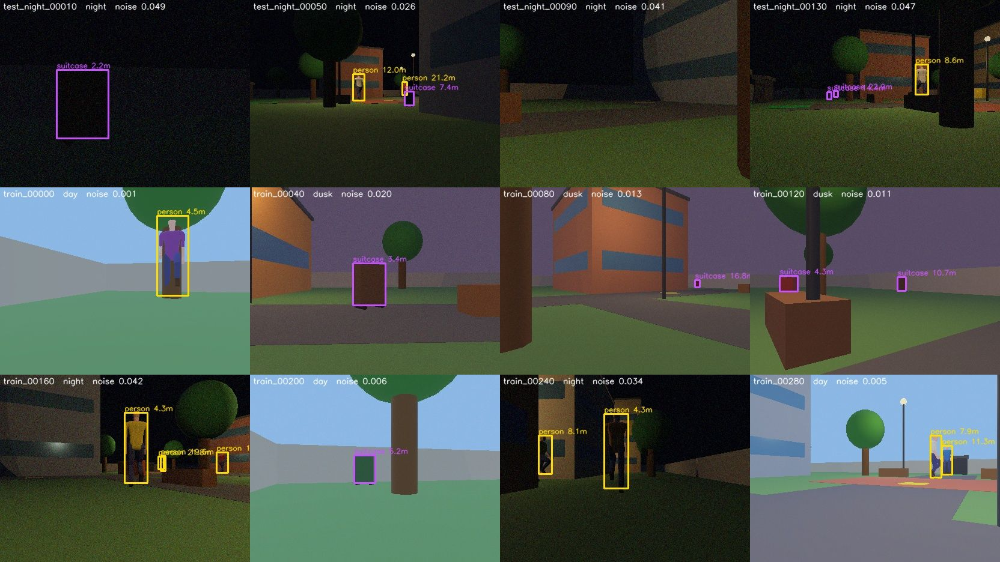

# Vision-Based Autonomous Campus Security Robot

**Foundations of Computer Vision project · Karunya University**

Two autonomous robots patrol a simulated university campus **at night**. They detect people and unattended suitcases with a **YOLOv8 model we trained on our own auto-generated dataset**, track people across frames, flag loitering, and raise alerts on a live web dashboard.




## Key results

On a held-out set of **150 night images** (144 people, 108 suitcases), never seen during training:

| Metric | Pretrained YOLOv8n (COCO) | **Our campus-trained YOLOv8n** |
|---|---|---|
| mAP@0.5 | 0.459 | **0.912** |
| Person recall | 0.66 | **0.88** |
| Suitcase recall | 0.05 | **0.90** |
| Person recall, far (> 12 m) | 38 % | **78 %** |



**Findings**

1. **Domain-specific training beats image enhancement.** Our model's *worst* score (0.836) is almost double the pretrained model's *best* (0.477).
2. **Enhancement cannot add knowledge.** No pipeline lifted the pretrained model's suitcase recall above 5 %.
3. **Enhancement hurts a matched model (distribution shift).** Our model was trained on raw night images, so gamma correction dropped it from 0.912 to 0.836. The robot therefore turns enhancement **off** with our model and **auto** with the pretrained one.

| Per class | Recall by distance |
|---|---|
|  |  |

## Computer vision pipeline

Every 0.5 s, each robot runs:

1. **Capture** a 416×312 camera frame (dark, noisy night scene with street lamps)
2. **Enhance** (optional): bilateral / median denoise → automatic gamma → CLAHE on the LAB L-channel
3. **Detect** people and suitcases with YOLOv8n
4. **Locate**: camera–LiDAR fusion (pinhole bearing + LiDAR range, camera size-based fallback) → campus map coordinates
5. **Track** in map coordinates: constant-velocity alpha-beta filter + HSV colour-histogram appearance (Bhattacharyya) + Hungarian assignment, with re-identification
6. **Score threats** (night, restricted zones, crowds, unattended objects, loitering) → investigate → confirm → alert

| Camera confirms the unattended suitcase | Loitering detected from tracks |
|---|---|
|  |  |

## Automatic dataset generation

Hand-labelling 900 images would take days, so a **supervisor camera robot** builds and labels the dataset itself:

- randomises lighting (day 35 % / dusk 30 % / night 35 %), camera pose (2–14 m from a target) and suitcase placement
- projects each object's 3D bounding box into the image (pinhole model) to get the 2D box
- uses the **depth image** to drop objects less than 25 % visible (occlusion), with ground removal
- adds realistic sensor noise and writes YOLO-format labels

**900 images · 902 person boxes · 626 suitcase boxes** · train 600 / val 150 / test_night 150



The full dataset is not stored in this repo; regenerate it by opening `worlds/dataset_capture.wbt` in Webots and pressing Play. Labelled samples are in `dataset/previews/`.

## Training

Transfer learning from COCO-pretrained YOLOv8n on a Google Colab T4 GPU (`training/train_campus_yolo.ipynb`): 60 epochs, image size 416, batch 32, strong brightness augmentation (`hsv_v=0.6`), flips and mosaic. Validation: **mAP50 0.916, mAP50-95 0.727**. Curves and confusion matrix are in `training/results/campus/`.

## Robot platform

Built on our [InteliPatrol](https://github.com/Janicejoyel/InteliPatrol) robotics project:

- occupancy-grid costmap with inflation, static vs transient (moving) obstacles
- A\* path planning and pure-pursuit path following on a skid-steer robot
- behaviour state machine: PATROL, SCAN, INVESTIGATE, ALERT, AVOID, RETURN_TO_BASE, CHARGING
- 2-robot fleet: shared telemetry "blackboard", task reallocation while charging, shared alert memory
- live Flask dashboard with map, tracks, alerts and camera images

## How to run

Requirements: [Webots R2025a](https://cyberbotics.com/), Python 3.10.

```bash
pip install -r requirements.txt
```

1. **Dashboard** (terminal, in this folder): `python dashboard/app.py`, then open http://localhost:5000
2. **Simulation**: in Webots, *File → Open World →* `worlds/campus.wbt`, then press ▶ Play
3. The console should show `campus_yolo.pt ready (campus-trained, enhancement off)`

### Reproduce the experiments

| Step | Command / action |
|---|---|
| Generate dataset | Webots: open `worlds/dataset_capture.wbt` → Play |
| Train | Run `training/train_campus_yolo.ipynb` on Colab (or `python training/train_local.py`) |
| Evaluate pretrained | `python tools/eval_detection.py` |
| Evaluate ours | `python tools/eval_detection.py --model models/campus_yolo.pt` |
| Report charts | `python tools/make_report_charts.py` |
| Enhancement ablation (robot frames) | `python tools/enhancement_eval.py` |
| Tracking map | `python tools/plot_tracks.py` |

## Repository structure

```
VisionSecurityRobot/
├── worlds/                  campus.wbt (patrol) and dataset_capture.wbt (dataset generation)
├── protos/PatrolBot.proto   robot: 4 wheels, camera, LiDAR, GPS, IMU
├── controllers/
│   ├── patrol_controller/   robot brain, costmap, A*, vision, tracker, threat scoring
│   └── dataset_collector/   automatic dataset generation and auto-labelling
├── models/                  yolov8n.pt (COCO) and campus_yolo.pt (ours)
├── training/                Colab notebook and training results
├── tools/                   evaluation, ablation, tracking and chart scripts
├── results/                 evaluation outputs and report charts
├── dashboard/               Flask control-room dashboard
├── dataset/                 data.yaml, previews and contact sheet (full set regenerable)
└── docs/                    screenshots and evidence (alerts, tracking, enhancement)
```

## Limitations and future work

- Trained and tested in simulation; real campus night images would be needed for deployment.
- Tracking fragments IDs when people leave the camera view (17 IDs for 5 people in one run).
- Next steps: real-robot deployment with ROS 2, real-image fine-tuning, deep re-ID features.
